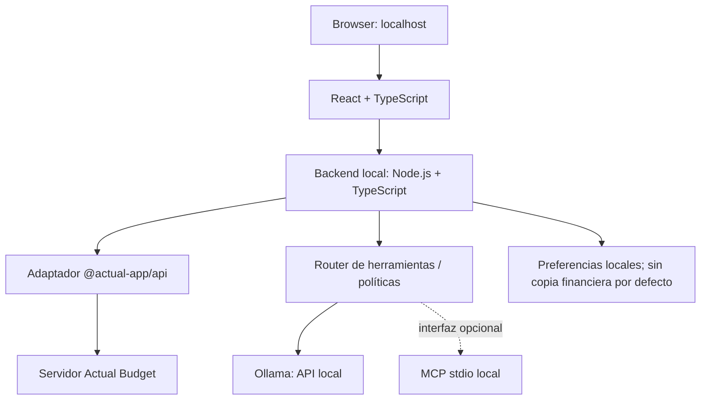

# Arquitectura

## Resumen

`personal-budget` está diseñado como una aplicación web local. El navegador presenta una única interfaz. El backend coordina los accesos a Actual Budget y Ollama; no se conecta el navegador directamente a la base de datos financiera ni al modelo.

## Componentes

| Componente | Responsabilidad | Límite principal |
|---|---|---|
| Frontend | Dashboard, formularios, gráficos, chat y confirmaciones | No guarda credenciales ni llama directamente a Actual/Ollama |
| Backend | Validación, permisos, cálculos agregados, límites y coordinación | Escucha en localhost por defecto |
| Adaptador Actual | Inicializar `@actual-app/api`, abrir el presupuesto y ejecutar las operaciones aprobadas | Único componente que accede a las funciones de Actual |
| Actual Budget | Fuente de verdad para cuentas, categorías, presupuestos y movimientos | No sustituir ni editar su almacenamiento interno directamente |
| Router de herramientas | Valida llamadas de modelo y dirige a funciones explícitas | Lista permitida; sin shell ni SQL arbitrario |
| Ollama | Generación local de respuestas y llamadas a herramientas compatibles | La compatibilidad depende del modelo/runtime elegido |
| MCP opcional | Expone herramientas revisadas a clientes MCP locales | Transporte stdio por defecto; no servidor público sin autenticación |
| Preferencias de la app | Ajustes de interfaz y, si se habilita, metadatos no sensibles | No duplicar movimientos ni almacenar historial financiero sin necesidad |

## Flujo de datos

1. El usuario crea o importa movimientos en Actual Budget o mediante las funciones explícitas de la aplicación.
2. El backend consulta los datos a través del adaptador oficial de Node.js.
3. Los agregados financieros se calculan con código determinista.
4. Para preguntas en lenguaje natural, el backend envía al modelo local solo el contexto necesario y las definiciones de herramientas permitidas.
5. Si el modelo solicita una herramienta, el backend valida argumentos, ejecuta una función aprobada y devuelve resultados estructurados.
6. La interfaz presenta cifras, periodo, divisa y supuestos. Las operaciones de escritura quedan pendientes de confirmación.

## Fuente de verdad y duplicación

Actual Budget es la fuente de verdad financiera prevista. No crear una segunda base de movimientos paralela salvo que exista una justificación clara. La app puede almacenar preferencias técnicas, filtros guardados o metadatos de UI por separado. Cualquier caché debe poder regenerarse y tener una política de retención explícita.

## Reglas de cálculo

- Ingresos y gastos se agregan por fecha de transacción y divisa.
- Ahorro del periodo = ingresos netos del periodo menos gastos netos del periodo, con reglas explícitas para reembolsos.
- Tasa de ahorro = ahorro / ingresos × 100; si los ingresos son cero o negativos, mostrar «no aplicable» en lugar de dividir.
- Los traspasos entre cuentas propias se excluyen de ingresos/gastos consolidados para evitar doble conteo, pero se muestran como movimientos de cuenta.
- Un reembolso debe reducir la categoría de gasto correspondiente cuando pueda identificarse de forma fiable; si no, debe quedar visible para revisar.
- No sumar distintas divisas sin un tipo de cambio explícito y fechado.
- Los datos ausentes se muestran como desconocidos, no como cero.
- Las previsiones deben etiquetarse como estimaciones e identificar los supuestos.

## Límites de alcance inicial

- Sin conexión bancaria automática.
- Sin asesoramiento de inversión, impuestos o crédito.
- Sin acceso público remoto.
- Sin acciones financieras externas ni ejecución de pagos.
- Sin ejecución de código generado por el modelo.
- Sin analítica ni telemetría de terceros por defecto.
