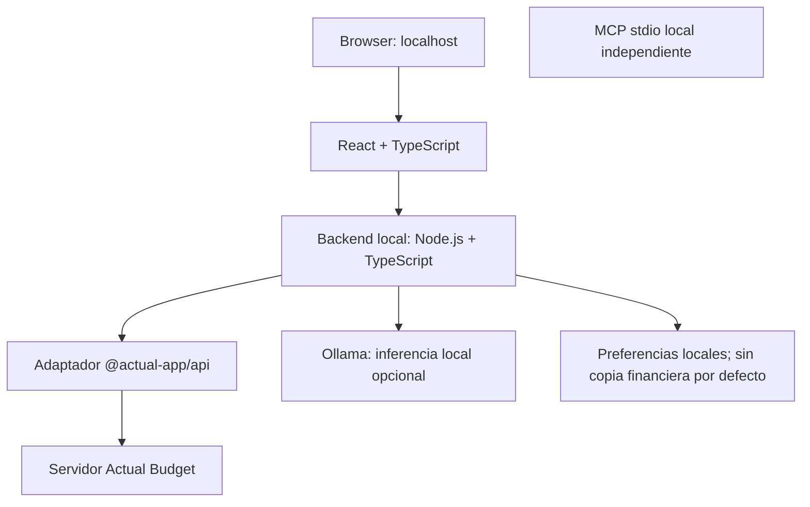

# Arquitectura

## Resumen

`personal-budget` está diseñado como una aplicación web local. El navegador presenta una única interfaz. El backend coordina los accesos a Actual Budget y Ollama; no se conecta el navegador directamente a la base de datos financiera ni al modelo.

## Componentes

| Componente | Responsabilidad | Límite principal |
|---|---|---|
| Frontend | Dashboard, formularios, gráficos, chat y confirmaciones | No guarda credenciales ni llama directamente a Actual/Ollama |
| Backend | Validación, permisos, cálculos agregados, límites y coordinación | Escucha en localhost por defecto |
| Adaptador Actual | Inicializar `@actual-app/api`, abrir el presupuesto y ejecutar las operaciones aprobadas | Único componente que accede a las funciones de Actual |
| Actual Budget | Fuente de verdad para cuentas, categorías, presupuestos y movimientos | No sustituir ni editar su almacenamiento interno directamente |
| Capa de IA local | Prepara contexto agregado y solicita una explicación cualitativa | Una inferencia por petición; sin herramientas ni operaciones de escritura |
| Ollama | Generación local de respuestas y llamadas a herramientas compatibles | La compatibilidad depende del modelo/runtime elegido |
| MCP opcional | Expone herramientas revisadas a clientes MCP locales | Transporte stdio por defecto; no servidor público sin autenticación |
| Preferencias de la app | Ajustes de interfaz y, si se habilita, metadatos no sensibles | No duplicar movimientos ni almacenar historial financiero sin necesidad |

## Flujo de datos

1. El usuario crea o importa movimientos en Actual Budget o mediante las funciones explícitas de la aplicación.
2. El backend consulta los datos a través del adaptador oficial de Node.js.
3. Los agregados financieros se calculan con código determinista.
4. Para preguntas en lenguaje natural, el backend valida el ámbito, calcula los agregados en código determinista y prepara un contexto JSON compacto.
5. El backend realiza como máximo una inferencia local por petición. El modelo no recibe herramientas, no consulta movimientos y no ejecuta operaciones.
6. La interfaz presenta los importes calculados por `finance-core` y muestra por separado la explicación cualitativa. MCP mantiene una interfaz read-only independiente del chat.

## Fuente de verdad y duplicación

Actual Budget es la fuente de verdad financiera prevista. No crear una segunda base de movimientos paralela salvo que exista una justificación clara. La app puede almacenar preferencias técnicas, filtros guardados o metadatos de UI por separado. Cualquier caché debe poder regenerarse y tener una política de retención explícita.

## Reglas de cálculo

- Ingresos y gastos se agregan por fecha de transacción y divisa.
- Ahorro del periodo = ingresos netos del periodo menos gastos netos del periodo, con reglas explícitas para reembolsos.
- Tasa de ahorro = ahorro / ingresos × 100; si los ingresos son cero o negativos, mostrar «no aplicable» en lugar de dividir.
- Los traspasos entre cuentas propias se excluyen de ingresos/gastos consolidados para evitar doble conteo, pero se muestran como movimientos de cuenta.
- Un reembolso debe reducir la categoría de gasto correspondiente cuando pueda identificarse de forma fiable; si no, debe quedar visible para revisar.
- No sumar distintas divisas sin un tipo de cambio explícito y fechado.
- Los datos ausentes se muestran como desconocidos, no como cero.
- Las previsiones deben etiquetarse como estimaciones e identificar los supuestos.

## Límites de alcance inicial

- Sin conexión bancaria automática.
- Sin asesoramiento de inversión, impuestos o crédito.
- Sin acceso público remoto.
- Sin acciones financieras externas ni ejecución de pagos.
- Sin ejecución de código generado por el modelo.
- Sin analítica ni telemetría de terceros por defecto.

## IA local: límites de contexto y recursos

La IA es opcional y solo explica agregados que el backend ya calculó. El chat no expone herramientas ni delega consultas, escrituras o planificación al modelo. Los cálculos numéricos siguen siendo responsabilidad de \`finance-core\`.

- La disponibilidad de Ollama se cachea durante 5 segundos; una inferencia fallida invalida el estado para detectar antes una caída o recuperación.
- El contexto se compacta antes de serializarlo como JSON válido: se descartan categorías y avisos de menor prioridad antes de reducir datos. Nunca se corta la cadena JSON ya serializada.
- La llamada usa \`num_ctx=2048\` y \`num_predict=384\`. Se reserva un presupuesto de hasta 1536 tokens estimados para entrada; la estimación utiliza caracteres por token como límite conservador, no sustituye el tokenizador específico del modelo. El límite \`AI_MAX_CONTEXT_CHARS\` (512–8000; valor por defecto 4000) también se respeta.
- El cliente permite hasta 2 inferencias simultáneas y 4 solicitudes en espera. Al llenarse la cola responde con un error temporal explícito en lugar de crecer sin límite.
- Solo se agrupan solicitudes concurrentes cuando coinciden la pregunta, el contexto agregado completo, el periodo, la divisa y la huella interna de cuentas. Los identificadores internos no se envían al modelo ni se registran.
- Se propaga la cancelación del cliente a la inferencia cuando es posible, se aplica el timeout configurado y no hay reintentos automáticos.
- La telemetría estructurada registra duración, espera en cola, estimación de entrada, tamaño del contexto, resultado y llamadas al modelo. No registra prompts, nombres de cuenta, categorías, movimientos ni importes.

Las pruebas de IA utilizan fixtures sintéticos y no requieren descargar ni ejecutar un modelo. Con Ollama desactivado, lento o no disponible, las funciones financieras restantes siguen operativas.
